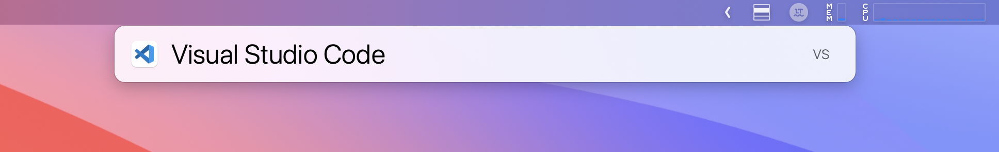

# Get Recent Visual Studio Code Documents for LaunchBar

[](https://www.obdev.at/products/launchbar/index.html)
[](LICENSE)

This repository provides an action for [LaunchBar](https://www.obdev.at/products/launchbar/actions.html) for accessing recent documents opened with [Visual Studio Code](https://code.visualstudio.com/). The actions are designed to streamline access to recent files for users of Visual Studio Code.



## Contents

This repository includes the following components:

- **Action**: Pre-packaged LaunchBar action in `Get-Recent-VS-Code-Documents-For-LaunchBar.zip`, attached to each [release](https://github.com/alberti42/Get-Recent-VS-Code-Documents-For-LaunchBar/releases), to enable direct access to recent documents. The bundle is in `Actions/`.

## Installation

### Option 1: Manual Installation

1. **Download** the pre-packaged action from the [Get-Recent-VS-Code-Documents-For-LaunchBar.zip](https://github.com/alberti42/Get-Recent-VS-Code-Documents-For-LaunchBar/releases/latest/download/Get-Recent-VS-Code-Documents-For-LaunchBar.zip) of the latest release.
2. **Extract** the contents, which include:
   - `Recent VS Code Opened Files.lbaction`
3. Place these `.lbaction` files into your LaunchBar Actions folder:
   ```
   ~/Library/Application Support/LaunchBar/Actions
   ```

4. **Restart LaunchBar** to load the new actions.

### Option 2: Automatic Installation

Alternatively, you can simply double-click each `.lbaction` file. This will automatically install the action in LaunchBar.

## Compilation Instructions

The action runs the Python script `Contents/Scripts/default.py` and contains no compiled code, so there is nothing to compile. Requirements: `python3`.

1. **Pack** the action:
   ```
   bin/build_actions.sh
   ```
   The script copies the bundle from `Actions/` to `build/Actions/`, without `__pycache__` and `.DS_Store`, and packs it into `build/Get-Recent-VS-Code-Documents-For-LaunchBar.zip`.

2. **Install** the action by double-clicking the bundle in `build/Actions/`, or copy it to:
   ```
   ~/Library/Application Support/LaunchBar/Actions
   ```

## Releasing

`CHANGELOG.md` is based on [Keep a Changelog 1.1.0](https://keepachangelog.com/en/1.1.0/), and this project adheres to [Semantic Versioning 2.0.0](https://semver.org/spec/v2.0.0.html). Pre-releases carry a `-beta.N` suffix (`vX.Y.Z-beta.N`).

1. Describe the changes under `## [Unreleased]` in `CHANGELOG.md` (Keep a Changelog 1.1.0).
2. `bin/bump_version.sh vX.Y.Z` (or `vX.Y.Z-beta.N`): sets `CFBundleVersion` in `Actions/*.lbaction/Contents/Info.plist`, moves the `[Unreleased]` entries under the version with `bin/changelog.py` (releases only), commits and tags.
3. `git push origin main --tags`. The tag starts `.github/workflows/draft-release.yml`: pack the action, attest the build provenance of `Get-Recent-VS-Code-Documents-For-LaunchBar.zip`, and create a draft release with `Get-Recent-VS-Code-Documents-For-LaunchBar.zip`. The release notes are the version's `CHANGELOG.md` section and a link to the commits since the previous tag. The workflow fails if the tag does not match `CFBundleVersion`.
4. Publish the draft on GitHub. `.github/workflows/verify-release.yml` then checks the published `Get-Recent-VS-Code-Documents-For-LaunchBar.zip` (provenance, Info.plist, script); it also runs weekly.

To verify a downloaded `Get-Recent-VS-Code-Documents-For-LaunchBar.zip`:
```
gh attestation verify Get-Recent-VS-Code-Documents-For-LaunchBar.zip --repo alberti42/Get-Recent-VS-Code-Documents-For-LaunchBar
```

## Usage

- Activate LaunchBar and type the name of Visual Studio.
- Press space to display the recent documents directly from LaunchBar.

## Security

To report a vulnerability, see [SECURITY.md](SECURITY.md).

## Donations

If you find this plugin helpful, consider supporting its development with a donation.

[](https://buymeacoffee.com/alberti)

## Author

- **Author:** Andrea Alberti
- **GitHub Profile:** [alberti42](https://github.com/alberti42)
- **Donations:** [](https://buymeacoffee.com/alberti)

Feel free to contribute to the development of this plugin or report any issues in the [GitHub repository](https://github.com/alberti42/Get-Recent-VS-Code-Documents-For-LaunchBar/issues).
